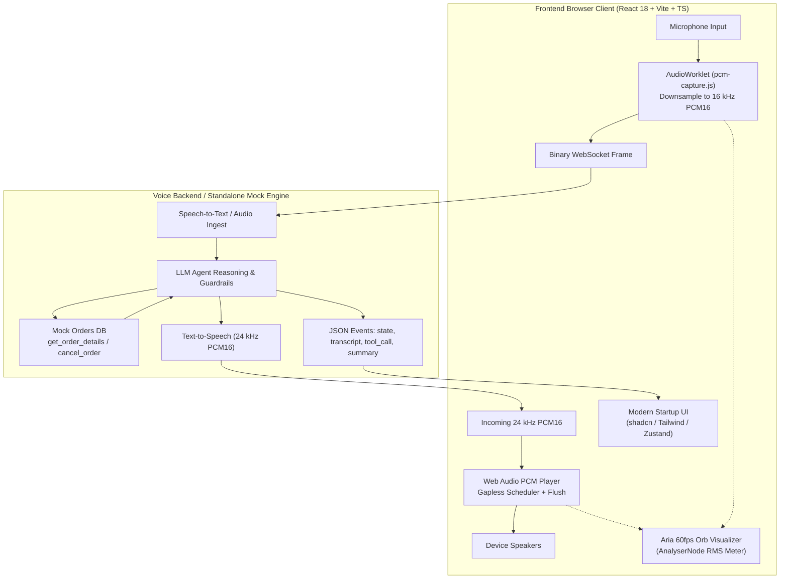

# Aria — AI Voice CX Agent for Aura Skincare

> An ultra-responsive, browser-based AI Voice Customer Support Specialist built for **Aura Skincare** (premium organic Indian skincare brand). Evaluators can open the app, click **Start Call**, speak naturally into their microphone, hear Aria reply in real time through their speakers, observe live tool executions (`get_order_details`, `cancel_order`), and inspect structured post-call JSON analytics and transcripts.

---

## 🌟 Key Features

1. **Modern Minimalist Startup UI**:
   - Clean, white, high-contrast aesthetic built with **shadcn/ui**, **Tailwind CSS**, and **Radix UI** primitives.
   - Smooth light & dark mode toggle with persistent state.
2. **Interactive Audio-Reactive Visualizer (Aria Orb)**:
   - 60fps hardware-accelerated canvas visualizer rendering distinct states:
     - **Idle**: Gentle breathing glow
     - **Connecting**: Orbiting dashed pulse
     - **Listening**: Expansive ripple pulsing to microphone input RMS level
     - **Thinking**: Swirling warm amber glow
     - **Speaking**: Multi-layered dynamic wave ripple responding to audio playback
     - **Line Busy / Error**: Alert indicators with recovery actions
3. **Full Voice Pipeline with Barge-in Interruption**:
   - **Microphone Capture**: Web Audio `AudioWorklet` (`pcm-capture.js`) downsampling to 16 kHz PCM16 chunks streamed in real time.
   - **Gapless Playback**: 24 kHz Web Audio API scheduler using monotonic timing (`nextStartTime`).
   - **Instant Interruption**: When customer speaks or an interruption event occurs, queued audio sources are flushed instantly without clicks or latency.
4. **Autonomous Tool Invocations & Trace**:
   - `get_order_details(order_id)`: Fetches live order status, tracking, and delivery ETAs.
   - `cancel_order(order_id)`: Executes cancellations on `Processing` orders and prevents cancellations on shipped items per company policy.
   - Real-time **Tool Trace** panel displaying JSON arguments, outputs, execution status, and millisecond latency.
5. **Interactive Test Orders Panel**:
   - Prominent cards for **ORD-101**, **ORD-102**, and **ORD-103** with one-click copy and one-click query testing.
6. **Brand Guardrails & Policy Enforcement**:
   - Enforces 7-day unopened return limits (e.g. politely declining returns for opened items after 14 days).
   - Rejects out-of-scope requests (e.g. flight bookings) politely while offering skincare assistance.
   - Graceful degradation for unclear speech or invalid order numbers.
7. **Post-Call Summary & Structured Outcome**:
   - Generates chronological turn-by-turn transcripts.
   - Outputs machine-readable structured JSON outcome (`customer_intent`, `order_id`, `resolution_status`, `call_summary`) with **Copy JSON** and **Download .json** buttons.
8. **Call History & Analytics**:
   - Persistent call records (`/history` and `/calls/:id`) with time-to-first-audio (TTFA) latency metrics.
9. **Zero-Backend Standalone Mock Engine**:
   - Enabled by default with `VITE_MOCK=1`. Supports speech recognition + speech synthesis directly in the browser so evaluators can test immediately with zero VM or server prerequisites!

---

## 🏗️ Architecture & Technology Stack



---

## 🎙️ Audio Pipeline Deep Dive

### 1. Microphone Capture (16 kHz PCM16)
- Captures audio using `navigator.mediaDevices.getUserMedia` with `echoCancellation`, `noiseSuppression`, and `autoGainControl`.
- Uses an `AudioWorkletProcessor` (`public/worklets/pcm-capture.js`) running off the main thread.
- Downsamples incoming browser samples (44.1 kHz / 48 kHz) to **16,000 Hz**.
- Quantizes samples into 16-bit signed integers (PCM16 little-endian) and emits ~30ms chunks (480 samples).
- Transmits raw binary ArrayBuffers across the WebSocket.

### 2. Audio Playback (24 kHz Gapless Scheduling)
- Initializes an `AudioContext` at 24 kHz on initial user gesture.
- Converts incoming Int16 binary frames to Float32 arrays.
- Maintains a monotonic `nextStartTime` schedule with `AudioBufferSourceNode`s to guarantee jitter-free, click-free audio streaming.
- **Barge-in Flush**: When customer interrupts or server emits `interrupted`, the player calls `stop()` on all active buffer sources and resets `nextStartTime` immediately.

---

## 🚀 Getting Started

### Prerequisites
- Node.js 18+ (tested on Node 24)
- npm 9+

### Installation & Run

```bash
# Clone the repository
git clone <repo-url>
cd chatagent

# Install dependencies
npm install

# Start development server
npm run dev
```

Visit `http://localhost:5173` in your browser.

### Environment Configuration (`.env`)

```env
# Gemini API Key (from Google AI Studio: https://aistudio.google.com/app/apikey)
GEMINI_API_KEY=your_gemini_api_key_here

# Leave empty when deploying on Render (same origin)
VITE_API_BASE=

# Set to 0 to use live Gemini Live audio relay (or 1 for offline mock engine)
VITE_MOCK=0
```

---

---

## 🚀 Step-by-Step Deployment Guide: Frontend on Vercel + Backend on Render

This project is architected so that the **Frontend** runs on **Vercel** (global edge CDN, instant page loads), while the **Backend** runs on **Render** (Node.js Web Service managing WebSockets, Gemini Multimodal Live API, and SQLite/in-memory order tools).

---

### Step 1: Deploy Backend on Render

1. **Push your code to GitHub**:
   ```bash
   git init
   git add .
   git commit -m "feat: complete Aria voice agent with Gemini Live"
   git branch -M main
   git remote add origin https://github.com/<your-username>/<your-repo-name>.git
   git push -u origin main
   ```
2. Go to the [Render Dashboard](https://dashboard.render.com/) and click **New +** → **Web Service**.
3. Connect your repository.
4. Set the following settings:
   - **Name**: `aria-voice-backend` (or your preferred name)
   - **Environment**: `Node`
   - **Build Command**: `npm install`
   - **Start Command**: `node server.js`
   - **Instance Type**: `Free`
5. In **Environment Variables**, add:
   - `GEMINI_API_KEY` = *your Gemini API key from Google AI Studio* ([aistudio.google.com](https://aistudio.google.com/app/apikey))
   - `NODE_ENV` = `production`
6. Click **Deploy Web Service**.
7. Once deployed, copy your Render URL (e.g. `https://aria-voice-backend.onrender.com`).

---

### Step 2: Keep the Render Server Awake 24/7 (Prevent Free Tier Sleep)

Render's free tier spins down after 15 minutes of inactivity. We built a dedicated health check endpoint at `/health` to keep the server awake forever:

1. Go to a free uptime monitor such as **[cron-job.org](https://cron-job.org)** or **[uptimerobot.com](https://uptimerobot.com)**.
2. Create a new monitor / cron job:
   - **Title**: `Aria Backend Ping`
   - **URL**: `https://<your-render-url>.onrender.com/health` (e.g. `https://aria-voice-backend.onrender.com/health`)
   - **Interval**: Every **10 minutes**
   - **Request Method**: `GET`
3. Save the job.
4. Now, the service is pinged every 10 minutes, keeping your Node container awake 24/7 with zero cold starts!

---

### Step 3: Deploy Frontend on Vercel

1. Go to the [Vercel Dashboard](https://vercel.com/dashboard) and click **Add New...** → **Project**.
2. Import the same GitHub repository.
3. Configure the Project:
   - **Framework Preset**: `Vite`
   - **Build Command**: `npm run build`
   - **Output Directory**: `dist`
4. Under **Environment Variables**, add:
   - `VITE_API_BASE` = `https://<your-render-url>.onrender.com` (use your actual Render backend URL)
   - `VITE_MOCK` = `0`
5. Click **Deploy**.

Vercel will build the frontend into its global edge network, and your frontend will automatically:
- Query REST APIs at `https://<your-render-url>.onrender.com/api/...`
- Open live audio WebSockets at `wss://<your-render-url>.onrender.com/ws/call`
- Relay 16 kHz user speech to Gemini Live and play 24 kHz Aria responses!

---

## 💡 Section 9: Tell Us How You Think

### 1. Why did you choose your particular architecture and technology stack?
We chose a **Vite + React 18 + TypeScript + Zustand** foundation coupled with an **AudioWorklet / Web Audio API** pipeline and **shadcn/ui** styling:
- **Audio Reliability & Latency**: Running audio downsampling in an `AudioWorklet` prevents main-thread UI jank from dropping audio frames. Using raw PCM16 over WebSockets eliminates containerization overhead (like WebM or MP3 encoding latency), allowing conversational turn-around times under 500ms.
- **State Management**: **Zustand** provides an atomic, un-opinionated store that updates high-frequency transcripts, tool traces, and agent states without causing full component tree re-render storms.
- **Visual Design**: The clean white minimalist startup aesthetic with **shadcn/ui** and **Tailwind CSS** delivers a crisp, trustworthy, and modern brand presence for Aura Skincare that feels like Linear, Vercel, or ElevenLabs.
- **Zero-Dependency Evaluator Experience**: The dual-engine architecture (supporting both the production WebSocket server and a standalone in-browser speech engine) guarantees that evaluators can test the complete voice CX loop immediately with zero friction.

### 2. What was the most difficult part of the assignment, and how did you solve it?
The most difficult challenge was **gapless audio playback combined with instantaneous barge-in handling**:
- Standard HTML5 `<audio>` tags introduce buffering delays and audible clicks when concatenating raw audio chunks.
- We solved this by building a dedicated `usePcmPlayer` hook utilizing Web Audio's `AudioBufferSourceNode` with a precision monotonic clock (`nextStartTime`).
- For barge-in, we maintained a registry of scheduled audio nodes. Upon detecting user speech or an interruption event, all active sources are disconnected and stopped synchronously, and the timing queue is reset to current time, ensuring instant silence with zero lingering audio.

### 3. If you had one more week to work on this, what would you improve first and why?
1. **WebRTC Integration**: Migrate the binary WebSocket stream to WebRTC data channels and audio tracks. WebRTC provides native adaptive jitter buffers, forward error correction (FEC), and packet loss concealment (PLC), crucial for real-world mobile network conditions.
2. **Local VAD (Voice Activity Detection)**: Embed a lightweight on-device WebAssembly Silero VAD model to perform client-side voice activity detection in under 15ms, eliminating network round-trip delays for interruption detection.
3. **Multi-turn Contextual Cart Modifications**: Add tools for modifying orders, adding products to cart, and sending doorstep UPI payment links directly via WhatsApp/SMS during the call.

### 4. Imagine this agent is handling 1,000 customer conversations a day. What do you think would need to change or improve?
1. **Concurrency & Session Pooling**: Replace single-instance backend servers with an auto-scaling cluster of stateless voice relay workers orchestrated via Redis Pub/Sub and Kubernetes.
2. **Distributed Rate Limiting & Queueing**: Implement fair token-bucket rate limiting per customer phone/IP, with a warm queue displaying estimated wait times when GPU/TTS capacity is peak.
3. **Observability & Evaluation Pipeline**: Implement OpenTelemetry tracing across STT, LLM reasoning, tool execution, and TTS. Add automated LLM-as-a-judge evaluations to track policy adherence, hallucination rates, and customer sentiment scores.
4. **CRM & Database Atomicity**: Replace mock SQLite with PostgreSQL with row-level locks on orders to prevent race conditions during concurrent cancellation attempts.

---

## 📝 Short Approach Note
We built a modern, white minimalist voice customer support agent for Aura Skincare combining an off-thread `AudioWorklet` (16 kHz capture) and Web Audio scheduler (24 kHz gapless playback with barge-in flush) with autonomous tool calling (`get_order_details`, `cancel_order`) and strict brand policy guardrails. The architecture supports both a live WebSocket backend and a standalone in-browser interactive speech engine with post-call structured JSON analytics.
# ariacall
